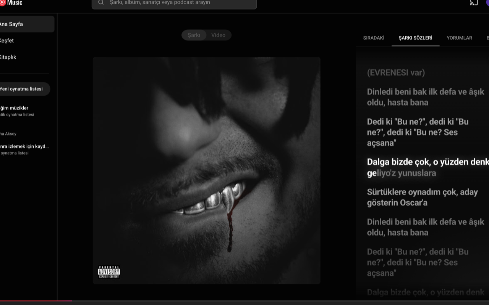

# YTM Lyrics+

Karaoke-style synchronized lyrics for YouTube Music — a zero-config Chrome extension that upgrades the built-in Lyrics tab with word-by-word highlighting, auto-scroll, click-to-seek, fullscreen mode, and an offline-capable lyrics cache.

## Features

- **Word-by-word karaoke** — when Apple Music TTML data is available (via [lrc.cx](https://lrc.cx)), each word lights up as it's sung. Otherwise timed lines get a smooth progressive fill.
- **Synced lyrics in the Lyrics tab** — the current line is highlighted and auto-centered while the song plays.
- **Opens itself** — when synced lyrics are found for a song, the Lyrics tab opens automatically (once per song; if you switch away, it stays away).
- **Click a line to seek** — any timed line jumps playback to its timestamp.
- **Right-click to re-sync** — if lyrics are slightly off (different intros on YouTube versions), right-click the line that should be playing. The offset is remembered per song.
- **Fullscreen lyrics** — a floating button expands lyrics into a distraction-free fullscreen view with auto-hiding cursor. `Esc` exits.
- **Works offline** — fetched lyrics and your sync offsets are cached in `chrome.storage`, so previously played songs show lyrics instantly — even with no connection.
- **Works when YouTube Music has no lyrics** — if the Lyrics tab is disabled for a song, YTM Lyrics+ enables it and pulls lyrics from LRCLIB or lrc.cx instead.
- **Smart fallbacks** — LRCLIB synced → LRCLIB plain → lrc.cx karaoke (TTML) → lrc.cx synced (LRC) → YouTube Music's own lyrics (restyled) → original UI untouched if nothing is found.
- **Ad-safe metadata** — track info is read from the player bar, so ads can't poison the lyrics lookup.
- **Ambient design** — album-art tinted background, distance-based line fading, smooth transitions.

## Install

### From source (developer mode)

1. Clone this repository.
2. Open `chrome://extensions` in Chrome and enable **Developer mode**.
3. Click **Load unpacked** and select the repository folder.
4. Open a song on [music.youtube.com](https://music.youtube.com) — lyrics appear on their own.

A Chrome Web Store listing is in progress.

## How it works

| File | Role |
|---|---|
| `manifest.json` | MV3 manifest — content script on `music.youtube.com`, `storage` permission, host permissions for `lrclib.net` and `api.lrc.cx` |
| `content.js` | Detects the Lyrics tab, injects the custom UI, tracks playback via `requestAnimationFrame` + binary search, word-level karaoke painting, manual resync, fullscreen, persistent cache |
| `background.js` | Service worker — provider chain (LRCLIB `/api/get` + `/api/search`, then lrc.cx `/jsonapi`), TTML/LRC parsers, request timeouts |
| `styles.css` | Spotify-style visuals, karaoke fills, fullscreen layout |

Lyrics lookup flow:

1. The content script reads the current track's title, artist, and duration from the YouTube Music player bar (DOM-first, so ads can't corrupt it).
2. The background worker queries LRCLIB for an exact match, falls back to LRCLIB search, then to lrc.cx (Apple Music catalogue data — preferring word-timed TTML entries, scored by title/artist/duration similarity).
3. Results are cached in memory and persisted to `chrome.storage.local` (30-day TTL for lyrics, 3-day for misses, ~250-entry LRU), so replayed songs load instantly and work offline.
4. `video.currentTime` drives the active-line highlight and per-word progress; a per-song offset corrects mismatched timings.

## Privacy

Only the current track's title, artist, album, and duration are sent to the lyrics providers (LRCLIB and lrc.cx) to find lyrics — and only when lyrics are being shown and not already cached. Playback position never leaves the page. Cached lyrics and sync offsets are stored locally in your browser. See [store/privacy-policy.html](store/privacy-policy.html) for the full policy.

## Notes

- YouTube Music's DOM is internal and undocumented — selectors are defensive: if a panel can't be identified, the extension silently stays out of the way instead of breaking the page. Set `window.__ytmlDebug = true` in the console for diagnostics.
- Word-by-word karaoke requires lrc.cx to have a TTML entry for the song; line-synced LRC is used otherwise, and static lyrics are the last resort.
- Set a custom timing offset by right-clicking a lyric line; click the `↺ sync` chip to reset it.

## Credits

- Lyrics data: [LRCLIB](https://lrclib.net), [lrc.cx](https://lrc.cx)
- Not affiliated with YouTube, YouTube Music, Google, or Apple.
